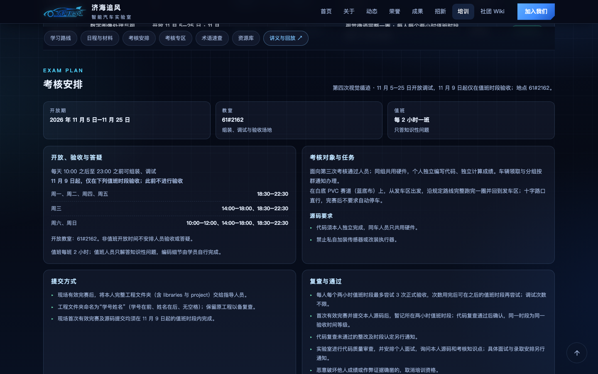
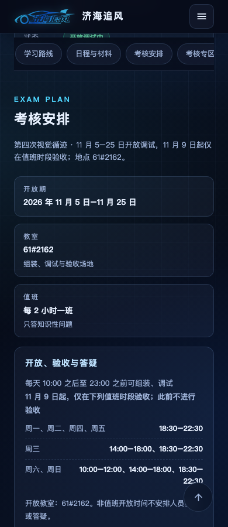

# 2026 年 11 月网站内容巡检

核对日期：2026-11-05。保留现有网站名称和视觉设计。

| 页面或区域 | 本次处理与依据 |
| --- | --- |
| 首页、动态 | 同步第四次软件培训开放调试、现行考核规则和第三次考核期结束；事件日期取自当次通知。新闻数据统一用于构建时预渲染和浏览器展示 |
| 培训中心、软件页 | 第二、三次转为历史阶段；加入第三次电机闭环课件及第四次视觉循迹 PDF。第四次规则依据 2026-11-04 考核母本和学员版通知，区分开放调试、验收开始日期和值班时段 |
| 硬件页 | 原定 10 月 30–31 日验收期已过；保留讲义和回放，后续安排及实际结果以群通知为准 |
| 招新页、Wiki 招新动态 | 区分一般咨询、自学与第四次考核参加资格；同步阶段、场地、时间及选拔流程 |
| 关于、荣誉 | 第 21 届表述为 8 支队伍获奖，其中 7 支获全国奖项；不以获奖队数代替全部参赛队数。补入团队证书已核实的第 20 届独轮信标、双车跟随、气垫越野、平衡轮腿及缩微光电成绩 |
| 成果与学习入口 | 保留现有成果报告；修复硬件赛道竞赛入口及成果页比赛实录入口，链接到实际生成的竞赛分类锚点 |
| 其他 Wiki | 已核对通用安全、设备借还、离室检查与工具准备页面；通用建议继续标注适用边界，第四次培训专用规则集中在当次安排中 |
| 公开讲义 | 第三次 HTML/PDF 共 32 页；第四次 PDF 共 42 页。第四次两张内部影像截帧改为教学示意图，去掉内部影像引用及按学号分车描述，不发布学员分组与内部执行流程 |

## 已完成验证

- 构建：5 篇 Wiki，21 个 HTML 页面及培训数据，共 673 个本地链接/资源检查通过；10 个主页面导航一致。
- 浏览器：1440、768、390 像素三种屏宽，每档 21 页；2052 次本地链接/资源检查通过，无页面脚本错误。官网和 Wiki 无横向页面溢出，横向导航可在自身容器内滚动。
- 交互：移动菜单、讲义入口、搜索与分类、打卡刷新后保留、旧赛道查询链接跳转、禁用 JavaScript 的首页和完整新闻列表均通过。
- PDF：第三次 32 页、第四次 42 页渲染检查通过；公开副本文字与新增文件经身份证号扫描，无命中；第四次无内部影像引用或学员分组。
- 依赖：`markdown-it` 更新至兼容修复版本；`npm audit` 为 0 漏洞。

## 审查截图

外链：本次出口探测 126 个 URL，99 个返回 200、20 个返回 206，7 个返回 403（Arena、Claude、OpenCV 文档两处、Gitee 公共仓库、Stack Overflow、知乎）。未发现 404；403 保留原链接并标记为访问受限，不据此认定链接失效。

第三、四次录播尚无经核实的独立视频地址，保留官方号获取渠道。Vercel 预览部署状态记录在 PR。
